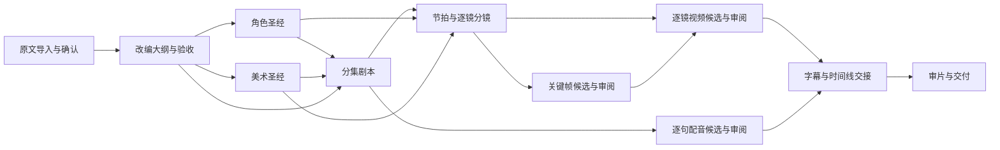

# 叙帧（Xuzhen）小说到视频工作台：研发实现规格（v1.5）

本规格把产品按“可控的制作流水线”定义。工作台负责组织项目数据、调用模型、记录来源与版本、让用户逐阶段验收；模型本身负责候选内容生成。所有生成结果先进入候选态，不自动覆盖已确认产物。

## 1. 产品目标与边界

用户从小说原文开始，逐步得到可审阅的改编大纲、角色/美术圣经、分集剧本、逐镜分镜、关键帧、视频、配音字幕和可交付成片。用户可控制每一阶段的范围、参数、引用资料、模型、批次、重试、验收、返工和导出。

首发版本不要求自研基础模型；文本、图像、视频必须均可通过 Provider Adapter 接入远程/自建 API，也可接入本机服务（如 ComfyUI）；语音同样采用适配器接入。适配器需统一任务生命周期与产物记录，模型差异通过 capability 和参数 schema 暴露。非结构化模型回答必须经 schema 校验、来源校验与领域校验后才能写入候选版本。

### 1.1 两种创作入口与共同生产线

新建项目时必须先选择创作来源，两条路线的事实依据、版权语义和前置门禁不同，不能用单一“上传小说”流程冒充原创能力。

**A. 已有小说改编**

`选择已有作品 → 原文导入/批次续传 → 章节结构与权利确认 → AI 原文分析 → 分析结果与出处审阅 → 视频改编大纲 → 角色/美术圣经 → 分集剧本 → 共用分镜/媒体生产线`。

原文分析需提取并结构化保存章节/段落 span、人物与别名、关系、事件、场景/道具、对白、时间线、伏笔和信息揭露；每项事实必须可回跳到 SourceSpan，模型推断须单独标注。文本过长时按章节/语义块切分，先生成章节摘要与人物状态，再用有版本号的项目记忆检索，避免把整本书直接塞入单次上下文。分析结果先作为候选；用户修订/确认后才可用于大纲生成。权利待核实的原著可以内部评估，但不得进入正式发布交付。

**B. 从创意原创小说**

`创意简报 → 故事圣经 → 分卷/分集/章节大纲 → 角色圣经 → 分批章节正文 → 通读/连续性审校 → 锁定原创小说版本 → 建立视频改编分支`。

| 原创阶段 | 生成输入与可控项 | 通过门禁 |
|---|---|---|
| 创意简报 | premise、题材、受众、叙事视角、风格、规模/单章字数、内容分级/禁写项、参考说明、版权声明 | premise、题材、目标受众和创作权利声明齐全；用户确认简报版本 |
| 故事圣经 | 故事核心、世界规则、人物目标/阻碍/代价、冲突引擎、结局方向 | 设定互不矛盾；人物目标与行动因果清楚；未解决问题显式列出并由作者决策 |
| 长篇大纲 | 分卷弧线、章节卡、冲突升级、角色变化、伏笔与回收、叙事视角 | 目标范围覆盖；章卡含目标/冲突/转折/钩子；因果与伏笔检查通过或逐项有理由豁免 |
| 文学角色圣经 | 角色身份、动机、秘密、关系方向/变化、行为边界与人物弧线；导入改编分支时按文学角色候选初始化角色列表，视频造型/声线字段保持待确认 | 角色候选用逐行结构化 roster（姓名、身份/目标、动机/秘密、人物弧线）；姓名唯一、字段齐全；作者接受版本；不直接定稿视频造型/声线 |
| 章节创作 | 按章节卡分批；字数、视角、风格、续写上下文、摘要记忆、拒绝词/禁区、重写范围 | 每章独立候选和版本；章节内容、beat/人物状态与大纲一致；拒绝候选不能被续写当成已接受正文 |
| 通读审校 | 用户声明的本次审校范围内已接受章节、章节摘要、角色/时间线/伏笔索引、风格规则 | 范围内章节必须全部有当前已接受版本；关键连续性 finding 已修复或作者逐项豁免。可审校部分范围并形成范围限定的 ManuscriptRelease；全书未完成状态必须明示 |
| 视频改编交接 | 锁定小说版本、所选且已接受的章节范围、集数/集长/画幅/平台、不可改边界 | 建立新的 AdaptationBranch 与章节映射；原著版本不覆盖；生成小说来源记录后，由用户确认结构/权利，再进入共用视频改编大纲和角色/美术验收 |

**角色圣经有两个用途层级**：原创/原著阶段的“文学角色圣经”描述身份、动机、秘密、关系与人物弧；视频制作阶段的“表演与视觉角色约束”增加可拍行为边界、镜头可见外观、服装连续性、声线和视觉锚点。视频角色卡可以继承文学角色字段，但必须在 AdaptationBranch 中确认或覆盖，不能把文学设定自动当作已锁定的视觉造型/声线。

**汇合规则**：两条路径都不能把小说正文直接送给图像/视频模型。路径 A 完成“原文事实与出处确认”，路径 B 完成“原创稿锁版与连续性审校”；随后各自建立一个具备来源版本、权利状态和章节映射的 `StorySourceVersion`。两者再走同一条 `视频改编大纲 → 角色/美术约束汇合 → 分集剧本/对白/节拍验收 → 逐镜分镜 → 关键帧 → 视频 → 后期 → 交付`。只有分集剧本的当前版本通过阶段门禁，才能创建正式分镜分支。探索生成可使用未验收输入，但须隔离并禁止交付。

**原创稿到视频剧本的内容变换**：先把原文章节映射为目标集卡（目标、冲突、转折、钩子、时长与删改理由），再把集卡展开为场次（内外景/时间、人物、动作、节拍范围、时长预算），再结构化对白（说话人、情绪、动作、原文/章节依据、预计时长），随后由编剧模型写成可拍剧本。章节、场次、beat、对白、镜头各层均保留 source_ref 或 adaptation_decision_ref，能反向追溯到锁定小说版本；不得把模型新编对白伪标为原著原句。

## 2. 阶段闭环与验收门（10 个可独立验收的阶段）

| 阶段 | 输入 | 用户控制 | 产物 | 进入下一阶段前的门禁 |
|---|---|---|---|---|
| 原文导入 | TXT/MD/DOCX/PDF/粘贴文本 | 编码、批次续传、章节切分、重复章节、忽略区间、来源/授权状态 | 原文版本、章节树、段落索引、解析报告、来源声明 | 至少一章解析成功；用户确认章节顺序/切分；来源权利状态已记录；解析错误可定位、重试 |
| 改编大纲 | 已确认原文、目标受众 | 题材、集数、集长、忠实/融合/重构、必保留/禁止改动、合并删减 | 故事核心、人物弧线、分集卡、原文证据引用 | 主线和因果检查；每集目标/冲突/转折/钩子完整；豁免须写原因 |
| 角色圣经 | 原文、大纲 | 角色身份、别名、关系弧、行为边界、声线、服装阶段、锚点角度 | 角色卡、关系边、服装表、声音设定、角色图资产 | 主角/本集出场角色有确认卡；关系冲突被解决或豁免；锚点不足可显式继续 |
| 美术圣经 | 大纲、人物、场景/道具出处 | 风格基线、色彩、镜头语言、场景空间方位/时间/灯光、道具状态与图像引用 | 场景卡、道具卡、视角参考图、style bible | 当前剧本所需资产可引用；无图可选择占位、跳过或生成；空间方位冲突提示 |
| 分集剧本 | 大纲、角色约束、美术设定 | 集/场范围、节拍、对白、动作、情绪、节奏、目标时长、续写点 | screenplay 版本、场次、beat、对白行及原文出处 | 时长检查、节拍覆盖、角色行为边界、场景可用性检查；逐项修改/接受/豁免 |
| 逐镜分镜设计 | 已确认剧本节拍、角色约束、场景/道具卡与视觉基线 | 镜头拆分、beat/对白映射、景别、角度、轴线、运动、时长、动作、画面/视频提示词 | Shot list、覆盖表、连续性报告、提示词版本 | 每个必需节拍/对白已映射或有豁免；总时长合法；轴线/视线/空间检查完成 |
| 关键帧生成与审阅 | 已确认 Shot list、参考资产、画风与图像提示词 | 图片服务、尺寸/画幅、候选数量、参考图/权重、重试策略 | 逐镜关键帧候选、参数快照、资产引用、检查报告 | 必需镜头都有已接受关键帧；失败项重跑或明确豁免 |
| 视频生成 | 已确认镜头及关键帧 | provider/model、时长、比例、分辨率、首尾帧、参考素材、运动强度、随机种子、并发、重试 | 每镜 video candidate、参数快照、时长/费用/耗时、错误与重试记录 | 本集必需镜头均有接受视频；失败、拒绝、内容不符均可单镜重跑/换模型/回退帧 |
| 配音、字幕、合成 | 接受的视频、对白映射、声音设定 | TTS 声线/语速/情绪、入出点、环境声/音乐、字幕、转场、混音响度 | 分轨音频、字幕轨、时间线、集成片版本 | 台词与镜头映射完整；同步检查通过；缺失/爆音/字幕错误可局部返工；影响范围预览 |
| 审片与交付 | 集成片、质量报告、来源/素材权利记录 | 审片批注、镜头退回、版本选择、编码/画幅/字幕/水印、投产包 | 母版、MP4、SRT/VTT、manifest、来源/授权清单、项目归档/提示词包 | 导出校验通过；审片决定和发布权利状态已记录；产物与来源版本可追溯 |

每个门禁状态为 `blocked / needs_review / ready / accepted / waived`。豁免需要角色、理由、时间和被豁免检查项。阶段重新打开创建新版本；下游只标记 `stale`，不级联覆盖。

**阶段依赖不是简单线性队列**：原文 → 大纲；大纲后角色圣经与美术圣经可并行（美术可依据大纲和角色提及先建场景/风格候选，不等待角色卡验收；剧本生成前必须合并确认的人物视觉约束）；分集剧本依赖大纲、角色、美术均通过；逐镜分镜设计依赖当前集剧本、角色、美术；关键帧生成依赖已确认镜头；视频和配音都依赖已验收剧本/分镜链路，其中配音可与关键帧、视频并行；后期依赖接受视频与逐句接受的配音；交付依赖通过后期质量门。阶段页面的可启动条件、画布 DAG 和上游失效计算必须读取同一 `depends_on[]`，不能按页面顺序推断依赖。返工某一并行分支只使它的真实后代 stale，不能误伤平行支线。



### 2.2 创作分支门禁与剧本汇合契约

- Project 创建时持久化 `creation_mode=adaptation|original`。原著路线的必经实体为 `SourceDocument → AnalysisRun → EvidenceItem → AdaptationOutline`；原创路线为 `CreativeBrief → StoryBible → NovelOutline → CharacterBible → ChapterDraft* → scoped ContinuityReport → scoped ManuscriptRelease`。两者生成的内容采用相同 Candidate/ReviewDecision/Version 语义。
- 每次节点运行存 `input_version_refs[]`、范围、prompt/template 版本、模型/Provider 能力快照、上游摘要索引版本、输出 schema 版本、attempt 和任务 ID。章节生成只能读取用户接受的上游章节或其摘要，不能把 rejected/pending 候选混入记忆。 章节批次只用于排队和成本汇总，不是事务边界：每章单独建 `GenerationRun` / Candidate / ReviewDecision；局部失败、取消或退回只影响对应章节，可单章重试；批次成功项保留。章节记忆更新仅在接受决策提交时发生，接受决策需绑定候选 ID 和输入版本。
- “开始阶段”只冻结输入与服务路由，不创建生成任务；只有明确的“生成 / 重写 / 批量生成”按钮才创建任务，避免一个阶段被隐式提交重复任务。AI 生成是候选写入，必须经过结构 schema 校验、确定性 lint、来源/权利检查和人工审核；系统应明确显示 generation、validating、needs_review、accepted、rejected、stale、blocked 的状态及恢复动作。
- `ContinuityReport` 验收时创建不可变 `ManuscriptRelease`，必须带显式 `chapter_scope[]`，锁定该范围的章节版本、作者/权利声明、连续性报告及未关闭 finding；不得把范围版标记为“全书完稿”。允许先发布已接受的子范围用于试拍，其他章节继续写作。改写范围内章节需生成新版本，重跑其受影响章节记忆、审校、章节映射和视频剧本后代；下游阶段在排队/生成/待验收时也须增加输入版本并标记候选过期，不能只使已确认节点失效；无关支线保持有效。
- 交接创建 `AdaptationBranch`，必须引用一个有效的 `ManuscriptRelease` 及其章节范围；导入/原文页须显示锁定版本 ID、章节版本、连续性报告来源和逐集映射快照，便于追溯；不能复制成一份无溯源的新小说，也不能覆盖原著版本。章节映射方案可逐集编辑；仅可选择该范围内章节，通过来源覆盖/完整度/时长门禁后生成视频改编大纲候选。用户扩大或缩小范围时，旧连续性报告、发布记录和适配分支明确保留为可查看的只读历史快照，新范围必须重跑审校并建立新分支；新分支初始化自己的集列表（数量与映射一致）、角色 roster（源自已接受文学角色圣经）、空白待生成剧本/对白/镜头、场景/道具与媒体状态；清理演示样例，剧本/对白页显示待生成空状态、实时统计当前分集时长/场次/节拍，不展示固定演示统计；空剧本、零镜头、无关键帧/视频候选不能通过质量门禁，除非留下可审计豁免。既有任务归档，旧分支任务/来源快照保留在只读历史，不得继承演示项目或旧分支的媒体数据。 映射契约为每个目标集一个 `EpisodeSourceMapping`：包含源章节/段落、改编目的、保留信息、允许改写边界、集尾钩子和作者处置；集数必须与映射行数一致，映射须覆盖所选范围内全部章节。AI 先交映射候选，作者逐集编辑后提交完整候选；确定性检查逐行校验集序、章节覆盖/越界、必填字段，缺项阻止接受。接受动作必须引用当前范围版 ID 与章节版本，之后才可建立正式剧本分支；“仅试拍”仍须登记实际使用的范围。
- 共用原文/来源门禁按入口验证不同证据：已有小说路径必须有 AI 分析候选、出处核验与覆盖确认；原创路径必须引用有效的 `ManuscriptRelease`、章节版本与连续性报告，不重复做原著事实抽取。接入共用工作区时不得残留模板演示人物/场景/剧本/对白/镜头；动态集数必须与已接受的映射一致，映射快照作为大纲生成的显式输入。原创来源范围和映射须作为改编大纲任务的冻结输入；原创路线的大纲检查以当前范围版、映射覆盖和当前版本已接受的大纲候选为依据，不要求伪造“原文必保留剧情”记录；改编集数变更必须先重新生成并接受映射候选。质量检查依据当前来源类型核验对应门禁。
- 两个分支共同要求 `ScriptRelease`：分集映射、场次、动作、节拍、对白、目标时长、角色/美术版本和来源映射全部锁定。只有 `ScriptRelease.status=accepted` 且引用版本未 stale，才能开 `ShotPlan`。从这里开始两种入口共享同一分镜、关键帧、视频、后期和交付服务。
- 改编参数弹窗持久化题材、集数、单集时长、画幅、改编模式与约束；校验范围并在变更时递增参数版本、使大纲及下游阶段待复核；原创分支集数锁定于已接受映射。
- 用户可以在创作入口与共用阶段页之间来回导航；路径模式不能因页面切换而改变。跨阶段更改必须显示影响清单和待重验收阶段，所有取消/失败操作保留上一个接受版本。

### 2.1 项目、分集与发布范围

生命周期分为项目级与分集级两种作用域，状态、版本、门禁、任务和返工影响必须按作用域隔离：

- **项目级**：原文导入与解析、改编大纲、角色圣经、美术圣经。原文/大纲是全项目基线；角色与美术允许创建项目公共版本，并按集派生局部覆盖。公共版本变更时，系统列出实际引用它的集，只有引用链上的产物标 stale。
- **分集级**：分集剧本、逐镜分镜、关键帧、视频、声音/字幕/合成、审片与交付。每集有独立状态、版本、候选、队列任务、门禁决定和导出记录；切换集后不得误用另一集的阶段状态或审阅决定。
- 阶段创建 `RunSnapshot` 时固定项目版本、集 ID、上游实体版本、服务配置和范围。批量跨集任务拆分为每集子任务；取消、重试、接受、豁免均可单集执行。
- 分集发布不是项目完成。项目概览须区分“集内制作完成”“待发布”和“已交付”；全季/整项目交付包另有聚合清单，列出缺集、未通过门禁、媒体校验和权利状态。只允许操作者显式选择部分集交付，并记录原因。
- 交付后发现问题时从审片批注创建 `DeliveryRevision`：记录问题类型/严重度/时间码、指定返工阶段和镜头、被替换交付 ID、修订原因、重新审片人及结论；原交付不可覆盖。修订只重跑被影响依赖的后代；关闭修订前必须完成返工阶段及其下游门禁，并验收一个新的 Delivery ID。项目归档可恢复但不能再排入生成任务，恢复需生成新的工作分支。

当前原型用项目级和每集独立的阶段状态存储，队列任务记录对应 episode_id。阶段控制弹窗展示作用域及每个上游的状态/过期标记；阶段依赖、画布 DAG、运行前检查和下游 stale 传播使用同一 `depends_on[]` 数据，不允许各页面各自推断。

## 3. 项目数据模型

所有记录使用 UUID、项目/集/阶段作用域、`created_at/updated_at`、`version`、`parent_version_id`、`status`、`created_by`、`source_refs[]`、`provider_snapshot`。核心实体：

- `Project`：题材、目标集数、时长、画幅、语言、默认 provider 配置引用、存储策略、来源权利责任人/状态。
- `SourceDocument / SourceBatch / Chapter / SourceSpan`：原文文件哈希、批次、章节树、字符偏移/页码位置、解析错误、来源类型与权利状态/凭据引用。
- `OutlineNode / Character / Relationship / Scene / Prop / StyleBible`：结构化内容及 `SourceSpan` 证据。
- `CreativeBrief / StoryBible / NovelOutline / NovelChapterDraft / ContinuityFinding / ManuscriptRelease`：原创作品的创作简报、世界/人物规则、章节计划、逐章候选、审校问题和只读锁版；文学角色圣经与视频角色卡通过 `derived_from_version_id` 关联，不共用可变记录。
- `AnalysisRun / EvidenceItem / InferenceItem / AdaptationDecision / StorySourceVersion / AdaptationBranch / ChapterEpisodeMap / ScriptRelease`：原著抽取证据与推断分开；两种来源锁定为版本化 StorySourceVersion；改编决策和章节映射追加保存；ScriptRelease 引用所有人物/美术/故事输入的确切版本。
- `Episode / SceneBlock / Beat / DialogueLine / Shot`：严格父子关系；镜头映射一个或多个 beats/对白并记时间范围。
- `Asset / AssetVersion / AssetReference`：文件 URI、缩略图、类型、角色/场景/道具关联、视角、服装/光照状态、校验和、引用用途与权重、来源及授权限制。
- `GenerationJob / JobAttempt / Candidate / ReviewDecision`：任务状态、幂等键、项目/集 ID、输入快照、provider/model、请求参数、耗时、费用、错误码、重试次数、候选产物和用户决策。
- `Timeline / Track / Clip / SubtitleCue / Export / DeliveryRevision`：可编辑时间线、音视频/字幕轨、转场、导出参数、文件校验结果及交付后修订链。
- `ProjectStageState / EpisodeStageState / GateDecision`：项目级与分集级阶段状态、输入版本、检查结果、接受/豁免人及原因。`DeliveryRevision` 必须在原 `Delivery` 之上追加，不能覆盖或删除历史交付。
- `AuditEvent`：用户操作、状态迁移、字段差异、恢复/回滚事件。

任何由模型生成的事实性内容均保留来源引用或标注“模型推断/无原文依据”。不要让一个大 JSON 成为唯一存储；按实体保存、版本快照可重建。

## 4. 任务状态与失败处理

`queued → validating → submitted → running → succeeded | failed | cancelled`; 另有 `retry_wait`, `paused`, `needs_review`。每次尝试独立记录；取消后不能伪装成功；超时、限流、鉴权失败、模型不可用、输出 schema 不合格、内容安全拒绝要有可读错误与下一步动作。重试使用指数退避、最大重试次数和幂等键；用户可对失败项改参数后创建新 attempt。长任务由后端 worker 执行，浏览器关闭不丢任务；UI 通过 SSE/WebSocket 或轮询更新状态。

批量生成按子任务拆分。单项失败不回滚成功项；展示批次整体进度、成功/失败/待审数，并允许仅重试失败项。任务提交前展示估算费用/时长（provider 不支持时标记未知），提交后锁定输入快照。

## 5. Provider Adapter 接口

统一接口建议：

```ts
interface ProviderAdapter {
  capabilities(): Capability[];
  validate(request: GenerationRequest): ValidationResult;
  submit(request: GenerationRequest, idempotencyKey: string): Promise<ProviderJobRef>;
  getStatus(ref: ProviderJobRef): Promise<NormalizedJobStatus>;
  cancel(ref: ProviderJobRef): Promise<void>;
  fetchArtifacts(ref: ProviderJobRef): Promise<ArtifactRef[]>;
}
```

`GenerationRequest` 至少包含 `task_type`、`model_id`、`prompt`、`negative_prompt`、结构化上下文、参考资产 URI/用途/权重、时长、宽高比、分辨率、seed、provider options、项目/阶段/实体 ID 和输入版本快照。服务端只通过注册的 adapter 调用 provider；密钥存 OS keychain/服务端 secret store，不进入浏览器 localStorage、项目 JSON、日志、导出包或前端错误栈。

### 5.1 三类服务都必须支持 API

文本、图片、视频均提供独立的服务配置，API 与本机服务是并列传输方式，项目可以混用（例如文本云 API + 图片本机 ComfyUI + 视频云 API）。不能把当前默认 ComfyUI 当成唯一可用路径。每种模态支持多个 `ServiceProfile`；项目为该模态选一个默认 profile，阶段/节点可选其他已登记 profile。每个 profile 至少有：`transport(remote_api|self_hosted_api|local_runtime)`、provider/adapter、endpoint、model/workflow ID、认证引用、能力快照、请求参数映射、超时、并发/限流、重试策略、启用状态和配置版本。阶段/节点可覆盖项目默认值；每个任务在提交时冻结实际配置与能力版本。

Provider 预设要明确协议边界：OpenAI-compatible 文本、provider 原生文本/图片/视频 API、本机 Ollama/LM Studio、ComfyUI，以及通过 adapter 注册的自定义 API。协议不兼容时必须实现对应 adapter，不能仅换 Base URL 就宣称兼容。能力注册表决定画幅、尺寸、参考图、首尾帧、时长、seed、回调/轮询等控件能否使用；不支持的参数须禁用并说明原因，禁止静默丢弃或无提示回退。

#### 项目内容外发授权门

服务配置通过连通性测试不等于用户同意发送作品内容。每个项目按模态（文本/图像/视频/语音）记录允许使用的 Provider Profile、处理区域、数据保留/训练条款审阅状态、授权人和时间；每个 RunSnapshot 保存所用 profile 与条款版本。原文、原创简报/章节、对白和引用素材只在项目显式允许该 profile 处理时外发。默认拒绝未授权云服务；本机/用户自建服务仍须提示其数据边界。更换 provider、endpoint、条款版本或模态时重新授权。未通过授权的 Preflight 必须阻断并提供“改用已授权本机服务 / 查看条款 / 授权此服务”的下一步；诊断模式也不得绕过法律/数据授权门。撤销授权阻止新 Run，运行中任务按用户选择取消或完成并提示。

### 5.2 密钥、连通性与任务路由

- 密钥在前端只能临时输入并通过 TLS 交给服务端/本机 Agent 的密钥库；服务端返回 `secret_ref`。服务 URL 必须拒绝用户名/密码、query string 和 fragment，避免密钥被误放进 URL 并写入浏览器状态或日志；远程 API 强制 HTTPS，HTTP 仅允许 loopback 或管理员显式配置的可信内网 Agent。浏览器不得将明文密钥放入 localStorage、项目数据、任务快照、日志、错误上报或导出包。读取密钥只发生在执行 adapter 的服务端进程。
- “测试连接”走服务端/Agent：分别报告网络/TLS、认证、模型/路由可用、能力发现，并返回脱敏错误码。原型中的同名按钮仅做格式检查，必须明示未发起网络请求。配置未验证可保存为草稿，但不可直接提交生产任务；用户显式试跑时进入受控诊断任务。
- 图片任务需映射 prompt/negative prompt、参考图及权重、画幅/尺寸、候选数量，归一化返回图片并登记 AssetVersion。视频任务必须支持 adapter 的 submit → remote job ID → running/progress → poll 或 webhook → fetch artifact → 校验媒体元数据 → 候选预览/验收，也要支持取消、超时、幂等去重和失败重试。文本支持同步/流式响应、上下文限制、JSON Schema 与领域校验。
- 每个 `GenerationJob` 保存不含密钥的 provider/model/endpoint(脱敏)/adapter 版本/能力快照/配置版本、输入版本、请求摘要、远程 job ID、attempt、状态、耗时和产物引用。队列必须展示服务路由和具体模型，让操作者能在失败后换服务并从失败项重试。
- 错误需区分 DNS/TLS/超时、401/403、路由或模型 404、429、服务端 5xx、协议解析失败、schema/领域校验失败、媒体下载/校验失败；提供可执行动作（修认证、检查模型 ID、退避重试、换 adapter、编辑参数或查看脱敏诊断）。不要把不同 API 错误都折叠为“生成失败”。


文本任务要求 JSON Schema 与语义校验；图像/视频任务保存请求与返回的实际尺寸、帧率、时长、模型版本、素材引用；ComfyUI adapter 需支持 workflow 模板版本、节点参数映射、websocket/历史查询、产物拉取和取消语义。模型不支持某参数时 UI 应禁用或显示能力差异，不能静默忽略。

### 5.3 项目默认、阶段覆盖与节点路由的闭环

- 项目服务配置是默认值；阶段与画布节点允许显式覆盖 Provider、模型、传输方式和能力参数。覆盖项需显示“继承项目默认”或“本节点覆盖”，避免用户误以为修改节点会全局切换。
- 提交前生成 `ResolvedGenerationConfig`：将项目默认、阶段覆盖、节点覆盖按优先级合并；列出最终 endpoint/provider/model、能力支持情况、缺失凭据、输入资产可访问性、预算/并发限制。任何必填项或能力不匹配都阻止正式提交并定位字段；允许的探索运行需标为非交付候选。
- `RunSnapshot` 和 `GenerationJob` 必须保存解析后的服务配置快照与版本号，不保存密钥，只保存 `secret_ref`。重试默认沿用原快照；用户选择“用当前配置重试”时创建新 attempt 并记录配置差异。节点配置变更只影响本节点及其后代，不改变已排队/运行任务。
- 画布上每个生成节点可独立选择已登记的 ServiceProfile，打开节点设置后看得到继承来源、当前能力、模型 ID 和连接状态；只允许输入未注册的 provider 名称是不合格实现。执行队列逐项显示最终路由；从节点失败重试时可只换该节点的 provider/model，保留输入版本并使受影响下游重新校验。
- 原型目前只模拟节点级 provider/model/transport 选择与队列快照，不验证此服务是否真的支持该模态/参数；正式执行前必须用 capability manifest 完成服务端校验。原型将配置元数据存入浏览器 localStorage，因此真实密钥绝不能填入原型；正式版应将配置放到后端/本机 Agent，并仅向浏览器返回脱敏信息。


## 6. 小说到分镜的专业处理规则

1. 原文解析生成“事实/人物/地点/事件/对白”候选，并带可回跳原文位置；用户确认后才进入改编依据。
2. 大纲生成先锁定约束：必保留事实、不能提前揭露的信息、角色行为边界、集数/集长；每个改编决策可追溯到原文 span 或用户指令。
3. 剧本结构化为场次和可拍摄 beats；每个 beat 有目的、动作、情绪变化、人物、场景、对白、时长区间。目标时长由台词字数/语速、动作时间、停顿共同估算，不用模型随意填一个数字。
4. 分镜依据 beat 逐镜拆解：每镜有可视动作、主体、景别、机位/方向、构图、运动、光线、对白区间、时长、连续性约束和所需素材。检查覆盖、轴线、视线、出入画方向、服装/道具状态、场景方位、镜头总时长。
5. 图像提示词由结构化镜头字段 + 已确认资产组装。保留人工编辑与 prompt template 版本，避免模型重写丢掉固定镜头事实。
6. 视频候选需绑定首帧/尾帧/参考素材及运动描述；生成后按镜头规格和连续性检查，用户可选候选、重试或回到关键帧。
7. 汇总时间线时按镜头时长和台词 timecode 建立 track；同步、字幕、响度、转场检查均给出可定位错误和局部修复操作。

## 7. 控制台必备交互

- 每阶段页头固定显示：阶段状态、当前版本、上游版本、输入引用、模型/服务、生成范围、成本/耗时估计、未通过检查数。
- “生成”先打开参数/范围/引用确认；“开始任务”后进入队列；产物进入候选集，出现逐项预览、接受、拒绝、编辑、重试、比较版本。
- “验收阶段”展示门禁 checklist 和豁免理由；验收后锁定版本。返工从当前版本分支，显示受影响下游，不自动覆盖。
- 所有危险或不可逆动作（删章节/镜头/素材、覆盖确认版本、批量替换引用）必须展示影响范围、撤销/恢复点和二次确认。
- 空状态提供下一步；错误状态提供错误码、人类可读说明、重试/换 provider/编辑参数/导出日志；加载和部分成功状态需区分。
- 所有筛选、排序、选择、批量选择、快捷键有可见反馈；按钮禁用时提示具体门禁/能力原因。

## 8. 交付与研发拆分

建议里程碑：

1. 项目/本地存储、导入解析、原文来源定位、章节确认、变更审计。
2. 大纲/角色/美术/剧本结构化编辑器、文本模型 adapter、schema/领域校验、版本和验收门。
3. 分镜/资产引用/质量检查、图像 adapter、候选审阅、关键帧版本。
4. 视频 adapter 和异步任务队列、重试/取消/并行、预算及成本快照。
5. 配音字幕时间线、局部合成、导出打包、端到端恢复与审计。

验收场景至少覆盖：集 1 和集 2 可处于不同阶段且切换时互不污染；全季包能定位缺集与失败集；交付后修订保留原包且可追溯；长文本分批续传不重复；生成不覆盖已确认版本；模型返回非法 JSON 可重试；provider 限流可恢复；一批部分成功可单项重跑；镜头改动只将相关下游标为过期；API Key 不出现在浏览器/导出；项目重启后任务和阶段状态可恢复；MP4、字幕和 manifest 的时间码/哈希一致。

## 9. 当前原型与真实产品的差距

`index.html` 是浏览器内交互/信息架构原型，不是生产系统。当前可演示：TXT/MD 导入批次、章节切分/排序/排除/编辑、来源权利登记；项目级/分集级阶段状态隔离；大纲证据和检查、角色/美术卡、分集场次、对白映射、字幕时间码的编辑与本地持久化；关键帧/视频/配音的逐项任务候选与接受；服务档案和画布计划；交付候选、审片修订与审计记录。阶段门禁、版本快照、下游 stale 标记、正式/内部交付区分都属于原型交互逻辑，须以本规格的数据模型和后端事务重新实现，不能以 localStorage 作为生产记录。

当前明确未实现：原文语义分析、角色参考图真实生成、内容外发授权的服务端 Preflight/撤销强制执行、DOCX/PDF 解析、多个并行项目管理、真实图片/视频/语音 API 调用、ComfyUI 工作流、密钥库、服务端任务队列/worker、任务进度回调、数据库迁移与生产级部署、文件/对象存储、真实媒体播放器/渲染器、成片编码、团队权限与完整审计安全。当前后端已支持 OpenAI 兼容文本 API：原创故事圣经、大纲、文学角色圣经、逐章正文、范围连续性报告及锁版后的逐集章节映射可以调用文本模型；映射候选必须引用当前有效锁版，完整覆盖锁版章节并保持连续原序，作者可逐集编辑后验收为追加式 `AdaptationBranch` 和映射快照。原创分支随后可生成分集场次/节拍大纲候选，确定性校验分支与锁版引用、集序、章节出处、场次/节拍序号和单集时长预算；作者验收后追加 `AdaptationOutlineRelease` 及逐集场景快照。后续视频角色约束、美术设定可在当前大纲范围内分别生成、编辑和验收；美术任务必须引用当前角色约束版本。分集剧本候选完整沿用已验收场次，引用锁版章节、当前大纲及角色/美术任务；原文直引由服务端逐字定位，剧本验收追加 `ScriptRelease` 快照。该纵切片同步运行在 API 请求中，不代表全书长期记忆、自动修订章节、finding 单项变更追踪或小说到视频已端到端打通；分镜、媒体生成及交付仍未完成。画布和队列中的演示任务不会产生媒体。画布的规划/启动 UI 是可审阅的交互草案，生产运行前必须由 Planner 输出经过 schema 与依赖校验的 plan，再由 scheduler 按 RunSnapshot 执行；不能把当前示例节点状态视为已经连通的工作流。任何验收文案均不能宣称原型已能真实产出视频。开发依第 18 节架构与 API 契约实现，并逐项通过第 19 节验收清单。

### 9.1 本轮原型闭环及研发验收要求

以下行为已在原型交互中表达，正式实现必须共享同一实体与版本源，不能只复刻静态页面：

- 每个导入批次单独记录来源/权利状态；章节结构确认后才能验收原文阶段。TXT/MD 解析与 DOCX/PDF 解析分别给出真实能力状态。
- 项目级源文、大纲、角色、美术状态与分集级剧本、分镜、关键帧、视频、后期、交付隔离；切集后任务、候选和审批按 episode_id 过滤。
- 角色、场景、道具、剧本、对白、字幕等编辑必须落在结构化记录上；编辑后递增版本、生成差异与事件记录，并按依赖图让实际下游失效。
- 图片/视频/语音产物逐项作为 Candidate；审批固定输入版本、参数、provider 快照、来源资产和审批人。上游变更后的候选不可进入正式下游任务。
- 关键帧绑定已确认镜头版本；视频候选绑定该镜头与接受的关键帧候选；配音/字幕绑定当前对白/剧本版本；合成只读取明确接受的媒体版本。
- 权利状态为待核实的素材只允许内部审阅包；正式交付须有权利校验结果。审片返工建立不可覆盖旧版本的修订记录；只有完成指定返工链并接受新的正式 Delivery ID 才可关闭修订。
- 每个页面按钮和弹窗均需有明确的前置条件、成功状态、失败/取消状态、持久化实体、审计事件及后续动作。研发验收时应使用第 19 节逐阶段场景验证，不能以“按钮可点击”代替闭环验收。

新增的“创作入口”页提供已有小说改编/创意原创两张路径卡；原创简报、故事圣经、大纲、角色、章节、连续性审校、交接均有输入弹窗、前置条件、任务队列、候选审阅/接受/退回和版本状态。服务设置增加按 Provider/Endpoint/模型/模态的项目内容外发授权；未授权远程任务在队列中显示“等待授权”，由用户同意后才能转为待运行（仅演示状态，服务端尚未强制）。已有小说页新增 AI 原文分析任务弹窗、抽取类别/范围/chunk 策略、证据核对门和分析状态。原创交接登记演示章节来源，回到原文结构/权利确认、AI 分析与共用改编阶段；该模拟文本不是 AI 生成的正文。

本原型的数据仍是单浏览器演示数据，刷新持久化依赖 localStorage；原型中的模拟/样例媒体与真实 provider 输出必须在 UI 上区分。真实项目应以 API 响应和服务端状态为准，离线/网络失败时显示同步状态和恢复动作。

## 10. 节点画布：阶段工作台的执行视图

加入可选的无限画布视图，与阶段 DAG 页面共享同一组 Project / Episode / Beat / Shot / Asset / GenerationJob / Candidate 记录。画布节点只保存对实体/版本的引用和可执行配置，不复制一份独立剧情或分镜数据。阶段页适合逐项校对、结构化编辑和验收；画布适合看依赖、替换模型/步骤、比较分支、局部重跑和观察中间产物。

### 节点与连线

- 节点类型：输入/解析、文本 LLM、角色/场景资产、Shot 结构化分镜、图片/关键帧、视频、TTS/音频、字幕、合成/导出、人工审阅、条件/路由、批量循环。
- 每个节点保存 `node_type`、`entity_refs[]`、`input_ports[]`、`output_ports[]`、参数 schema、prompt/template 版本、provider/model、状态、版本、锁定标记、任务 ID 和审阅决定。
- 连线保存 `source_node/output_port → target_node/input_port`、数据类型、映射规则和可选转换器。验证类型兼容、必需输入、环路、阶段依赖和权限；有向无环图为默认可执行图，循环只允许在明确的批处理/迭代子图中。
- 节点位置、缩放、分组、折叠状态和颜色属于 `GraphView` 展示配置；生产数据和执行图版本分开存储。

### 执行语义与可控性

- 执行前计算依赖图、节点缓存键、将执行/跳过/复用的节点、预计成本、并发和阻塞门禁；用户确认后形成不可变的 `RunSnapshot`。
- 改变节点参数或输入，递增该节点版本并把后代标为 `stale`；用户选择“仅当前节点”“从此节点重跑下游”或“重跑全图”。不相关分支复用缓存；明确锁定的输出不重算。
- 运行按拓扑顺序调度；独立分支可并行。失败节点显示错误、重试/换模型/编辑参数；下游停止或等待，用户选择继续旧候选或使用新候选。
- 每次运行有 `Run` 和每节点 `NodeRun` 记录：输入版本、参数/provider 快照、attempt、日志、费用/耗时、输出资产、状态、review decision。输出总是候选版本，需逐项或批量验收后才成为下游默认输入。
- 阶段门禁作为图中的不可绕过检查点节点。用户若显式允许试跑未验收输入，应标记为探索分支，不得被当成交付分支。
- 撤销/重做作用于画布布局和连接编辑；版本回退作用于生产数据，二者分离。复制节点时默认复制配置和引用，不复制密钥或运行状态。

### 小说短剧模板图

`原文导入 → 章节解析/确认 → 改编大纲/验收 → 角色圣经与美术圣经（大纲后并行；剧本前汇合） → 分集剧本/验收 → 节拍覆盖检查 → 逐镜分镜/连续性检查 → 关键帧生成/审阅 → 逐镜视频生成/审阅 → 配音字幕 → 时间线拼接 → 质量门禁 → 母版/投产包`。

角色/场景资产节点可以汇入每个镜头的 reference ports；台词行按 beat/shot 映射到 TTS 和字幕节点；一个关键帧节点可被替换而保留之后的视频节点配置，重跑时只刷新其后代。删掉分镜图节点、改用整体视频节点可以作为另一条分支，但必须提示用户失去逐镜审阅、首帧控制和镜头级返工。

### 画布交互与验收

至少提供拖拽、缩放、适配画布、小地图、框选、复制粘贴连线、对齐吸附、分组折叠、撤销/重做、搜索/定位、运行单节点/下游/全图、锁定输出、比较候选、查看输入/输出预览、任务进度、失败重试和版本差异。大图以缩略图/虚拟化渲染，媒体按需加载。

验收用例：循环连线被拒绝；不兼容的端口显示原因；改 prompt 只使后代失效；锁定节点执行时跳过；两条无关分支并行；部分失败只暂停后代并保留成功输出；恢复旧候选不覆盖历史；画布布局可恢复；阶段 gate 未通过不能提交正式交付分支。

## 11. AI 主导、人工辅助的默认体验

画布不能以“请先手工搭图”为入口。首次进入或阶段数据变化时，系统读取用户目标、已确认实体和 Provider 能力，自动生成一版带连线、参数、引用、校验规则、阶段门禁和并行计划的可执行草案。用户可以直接审阅计划并启动；拖拽、加节点、手动连线是可选的高级编辑方式。

默认路径：

1. **AI 规划**：根据当前项目/集/镜头范围生成节点图；每个建议节点说明用途、输入来源、输出格式、模型能力要求、成本/耗时估算、质量检查和被选理由。保留模型返回的结构化 plan JSON 与 Planner 版本。
2. **人工审阅**：用清晰的执行摘要显示将运行哪些阶段、跳过哪些已确认产物、哪些分支并行、哪些节点需要人审、预计资源，以及风险/缺失输入。用户可以逐项编辑范围、模型、提示词、参考素材、门禁强度和执行顺序；无需自己画线。
3. **启动与监督**：确认后由 scheduler 按依赖图执行。Agent 可在失败时建议换模型、降分辨率、补引用或重规划；所有变更先呈现 diff，用户批准后生效。任务以节点级进度和候选结果回流。
4. **逐关验收**：重要创作节点（大纲、角色卡、剧本、镜头、关键帧、成片）默认 `needs_review`；用户可逐项审阅、批量接受或要求局部修改。用户可以在项目设置中选择自动接受低风险中间步骤，但关键门禁不能被普通连线绕开。
5. **修改与再规划**：用户用自然语言指令修改，如“把第 3 镜改成老太太的反应近景，保留她手里茶杯，之后镜头全部重算轴线”。AI 输出结构化变更计划和影响图；确认后只更新关联节点与下游后代，保留旧版本和未受影响分支。

画布主按钮应是“AI 生成/更新流程”和“审阅计划并启动”。手动添加节点/连线放在次级工具栏，并提示这是高级编辑。AI 生成的默认 graph 仍可以局部锁定、替换 Provider、比较模型分支、编辑节点和返回阶段专用编辑器。

AI 自动运行与人工责任边界：普通格式转换、抽帧、批量图像等低风险且可撤销步骤可按项目策略自动继续；涉及剧情改编、角色外观定稿、镜头意图、关键帧选用、成片交付等主观或高成本决定，默认停在审阅门。不能把“节点运行成功”视为“内容正确”；内容验收依赖结构化规则和人工决定。

## 12. 统一状态机与事件语义（实现基线）

本节为前后端共同遵守的规范；状态文案可本地化，状态 key 不可直接用 UI 文案代替。

### 12.1 项目与阶段

`Project.status`: `draft → active → archived`；删除走软删除和保留期，不因删除项目记录而立刻删除共享/被引用资产。项目只有在创建成功且权限建立后进入 `active`。项目配置变更写 `AuditEvent`，不得改变已创建的 RunSnapshot。

`Stage.status`: `not_started | ready | running | needs_review | accepted | waived | blocked | stale`。只允许：`not_started→ready`（上游门禁通过）、`ready→running`、`running→needs_review`、`needs_review→accepted|waived|running`、`accepted|waived→running`（显式返工并创建新版本）、任意非删除状态因上游版本变化转 `stale`。`stale→ready` 必须重跑/复核依赖检查，不能只改状态字段。`blocked` 需有可定位的阻塞项。只有 `accepted` 或显式 `waived` 的上游能解锁正式下游；豁免保存 `check_id、reason、owner_id、risk_ack、created_at`。豁免不抹除失败项，也不能豁免权限、密钥、内容安全或文件完整性等系统硬约束。

每次开始/返工创建 `StageVersion`，包含上游版本引用、编辑基线、参数快照、状态和来源。重新打开已接受阶段创建子版本，旧版本只读保留；依赖图计算影响范围并将受影响下游版本标 stale。无依赖的分支不受影响。批量影响预览必须列出将失效的具体产物，用户确认后提交。

### 12.2 任务、attempt 与候选

`GenerationJob.status`: `draft → validating → blocked|queued → submitting → submitted → running → collecting → needs_review → accepted|rejected`；失败出口 `failed`，可中止出口 `cancel_requested → cancelled`；暂停仅限 provider/worker 支持暂停的任务，语义为 `pause_requested → paused → queued`。若 provider 不支持远端取消，UI 显示“本地停止等待”，不能谎报远端已取消。

- 用户一次“生成”产生一个 Batch/Run，拆成不可变子任务。每个子任务有唯一 `idempotency_key`；网络超时后先按 key 查询或安全重提，不重复扣费。
- 每次重试新建 `JobAttempt`，保存上一次错误和新快照；默认沿用原输入/配置。修改 provider、参数或引用则新 attempt 明确写差异并重新 preflight。
- 只有 `collecting` 已校验产物哈希、媒体类型、尺寸/时长/可解码性后才可进入 `needs_review`。候选 `accepted` 不等于阶段 accepted；阶段验收仍需单独通过 Stage Gate。
- 拒绝候选必须选原因（剧情错误、角色/场景不一致、技术质量、政策拒绝、其他）并可附批注/时间码。拒绝后允许编辑参数重跑、换服务、选旧候选或关闭该任务。接受后生成只读 CandidateVersion 并将其标为后续默认输入。
- 批次部分成功时保留已成功项；批次状态按子任务派生为 `running / partial / needs_review / complete / failed / cancelled`，不能只用单一百分比掩盖失败项。

## 13. 生成前校验（Preflight）与服务 API 交互契约

每次提交前服务端执行同一版 `PreflightService`，返回结构化结果，不能依赖前端检查：

```ts
type PreflightResult = {
  decision: 'ready' | 'blocked' | 'exploration_only';
  resolved_config: ResolvedGenerationConfig;
  checks: Array<{ id: string; status: 'pass'|'warn'|'fail'; message: string; entity_ref?: string; remediation?: string }>;
  estimates: { cost?: number; currency?: string; duration_seconds?: number; confidence: 'provider'|'historical'|'unknown' };
  invalidated_descendants: string[];
};
```

Preflight 必须检查：阶段门禁与上游版本、输入范围是否为空、必需 schema 字段、来源/引用完整性、资产可读且 MIME/hash 匹配、provider enabled/连接状态/secret_ref、model ID 与能力、参数范围、请求体大小/上下文限制、并发/速率/预算、输出存储余量、内容安全规则及幂等冲突。`fail` 阻止；`warn` 可继续但要求用户知情；`exploration_only` 产物打探索标签且不能直接进入交付阶段。记录检查规则版本和结果。

### 13.1 配置对象

```ts
type ServiceConfig = {
  id: string; project_id: string; modality: 'text'|'image'|'video'|'audio';
  transport: 'remote_api'|'self_hosted_api'|'local_runtime';
  adapter_id: string; adapter_version: string; endpoint: string; model_id: string;
  secret_ref?: string; auth_mode: 'none'|'bearer'|'header'|'provider_oauth';
  capability_manifest_version?: string; capability_snapshot?: Capability[];
  parameter_schema: JSONSchema; timeout_ms: number; concurrency: number;
  rate_limit?: {rpm?: number; tpm?: number}; retry_policy: RetryPolicy;
  enabled: boolean; connection_state: 'untested'|'ready'|'degraded'|'invalid'; version: number;
};
```

服务端配置优先级固定为 `node profile override > stage profile override > project default profile > workspace default`。每层可只覆盖部分字段；合并时生成完整配置并显示字段来源。密钥引用不可被下层覆盖为空而静默降级认证。删除被活动任务引用的配置要软删除，并保留任务快照。远端与自建 API 可以被工作区管理员白名单限制 host，防止 SSRF；禁止任意 URL 探测、重定向到内网、非 HTTP(S) 协议和未授权私网地址。

### 13.2 Adapter 最小协议

```ts
interface ProviderAdapter {
  discover(config: ServiceConfig): Promise<CapabilityManifest>;
  testConnection(config: ServiceConfig): Promise<ConnectionReport>; // secrets only server-side
  validate(req: GenerationRequest, caps: CapabilityManifest): ValidationResult;
  submit(req: GenerationRequest, idempotencyKey: string): Promise<ProviderJobRef>;
  getStatus(ref: ProviderJobRef): Promise<NormalizedJobStatus>;
  cancel(ref: ProviderJobRef): Promise<CancelResult>;
  fetchArtifacts(ref: ProviderJobRef): Promise<ProviderArtifact[]>;
  normalizeError(error: unknown): NormalizedProviderError;
}
```

同步文本/图片响应也规范化成已完成的 ProviderJob；流式 token 与状态事件分别传递，断线重连不得重复创建任务。异步任务优先 webhook，轮询作为 fallback；webhook 必须验签、去重、限定时间窗口，事件乱序时按 provider sequence/version 丢弃旧状态。轮询使用有上限的指数退避与 jitter，超时后进入可恢复失败并保留 provider job ref。适配器要做 provider 的入参/出参映射、错误归一化和超时；核心业务层不得散落厂商字段判断。

### 13.3 远端素材传递

本地文件不可直接作为云 provider 的引用路径。Asset Gateway 负责：校验权限与 MIME/hash → 生成短时签名 URL 或上传到 provider → 记录外部上传 ID/过期时间 → 任务完成后按保留策略清理临时副本。请求日志只存 asset ID 和脱敏 URI，不存签名 URL；签名链接不进入浏览器、审计日志或导出包。Reference 使用 `asset_id + asset_version_id + purpose + weight`，提交快照固定其版本。provider 返回文件须经安全下载（限制重定向、大小、MIME、DNS rebinding/私网目标）、病毒扫描/解码检查后才入正式资产库。

## 14. 小说改编、分镜与媒体质量校验规则

校验分为 deterministic lint（可自动判断）与 editorial review（需人审）；不能将模型自评当作通过证据。每个 finding 有 `rule_id、severity、entity_ref、evidence_refs、message、suggested_fix、waiver_policy`，严重级别为 `blocker / error / warning / info`。

| 阶段 | 可自动检查 | 人工必须判断 | 失败时的定位/修复 |
|---|---|---|---|
| 原文 | 文件格式/编码、空白页、重复哈希、章节序号冲突、段落偏移越界 | 切章是否合适、扫描件/OCR是否忠实 | 跳到页码/段落，调整切分、重跑指定区间 |
| 大纲 | 集数/字数/时长预算、必保留项覆盖、每集目标/冲突/转折/钩子字段齐全、引用存在 | 改编是否合理、删改是否破坏因果/人物弧 | 按集列缺项，可编辑约束后仅重生该集并保留原版本 |
| 角色/美术 | 别名冲突、关系边自环/重复、服装阶段缺失、场景卡方位字段空、素材引用失效 | 角色是否符合原文、风格/空间是否一致 | 定位角色/场景/章节证据；支持合并角色、拆分阶段、重绘参考资产 |
| 剧本 | beat 与场次归属、对白 speaker 存在、估算时长、台词过长、角色行为约束冲突候选 | 对白自然度、戏剧节奏、行为解释是否成立 | 跳至台词/beat；允许修改、删改、来源说明、局部重生成 |
| 分镜 | 每个必需 beat/对白映射≥1镜或显式豁免；总时长/单镜范围；镜头序号唯一；相邻轴线/视线/运动方向；道具/服装连续性引用存在 | 构图是否表达意图、切点是否有戏 | 用时间线/俯视方位图展示冲突；可生成桥接镜头或标注有依据的豁免 |
| 图片 | 尺寸/画幅/MIME/哈希、引用资产版本正确、角色/场景 prompt 字段齐全 | 角色脸、服装、空间、构图和画风一致 | 对候选逐张接受/拒绝；只替换关键帧并显示视频后代失效范围 |
| 视频 | 可解码、非空、时长/尺寸/帧率在服务约束内、首尾帧引用匹配、视频与镜头目标时长偏差 | 动作可读性、主体身份稳定、口型/画面质量 | 定位时间码；局部重跑/换模型/回关键帧；不得覆盖已接受版 |
| 声音/字幕/合成 | 音画时长、对白映射、字幕时间码不重叠、响度峰值/静音、轨道缺失、导出编码 | 声线表演、字幕断句、混音是否合适 | 跳至时间线错误片段，局部修复并重新校验受影响区间 |
| 交付 | 所有文件存在、哈希一致、manifest引用可解析、编码/画幅/时长正确、授权/水印字段完整 | 最终内容审片与发布许可 | 失败清单逐文件定位，重新导出；审片拒绝可退回指定阶段 |

时长估算由 `spoken_characters / configured_speech_rate + action_duration + pause_duration + transition_duration` 组成，规则/语速参数版本化；模型建议只是候选。连续性检查需项目建立空间方位图和屏幕方向：180°轴线跨越必须有明确过渡依据或用户豁免；单纯提示词文本不等同通过检查。机器视觉/LLM 发现只产生 finding 候选，除硬格式检查外不能自动判定创作内容合格。

## 15. 权限、协作、数据保留与恢复

- 角色：Owner（项目/成员/密钥/删除）、Producer（阶段范围、预算、门禁豁免）、Editor（内容/镜头/素材编辑）、Reviewer（批注/接受/拒绝）、Viewer（只读）。所有 API 配置按 project scope 授权；密钥只允许 Owner/指定管理员管理，任务查看者不能取出明文。
- 并发编辑采用实体版本号 + 乐观锁；保存冲突显示双方差异，用户选择合并或新分支，不能最后写入静默覆盖。队列 worker 对状态变更采用 compare-and-swap 和事务 outbox，确保 DB 状态与调度消息一致。
- 删除内容先检查引用关系并显示影响；普通删除进入回收站，可在保留期恢复。密钥撤销立即阻止新任务，活动任务按策略取消/继续并提示。导出包默认排除密钥、临时上传地址、内部错误栈和未授权素材；交付 manifest 只写必要的来源/授权状态和素材许可清单。
- 每项目可设置原文、提示词、媒体、provider 临时副本的保留期限/区域；永久删除要覆盖主存储、缓存、缩略图、临时上传和备份生命周期并留审计收据。服务商数据保留/训练条款需在配置页记录为管理员审阅信息，不得由产品推断。
- 自动保存有保存状态与离线队列；重连后按版本校验同步。服务端定期快照，项目级导出/恢复演练验证 source、实体版本、任务、审阅决策和资产引用可还原；布局和业务数据可分别恢复。

## 16. 用户流程闭环与按钮结果约定

1. **新建项目**：先设目标（集数/时长/画幅/语言/平台）和存储区域，再导入原文；可保存草稿。项目空态只出现当前最合适的下一步。
2. **服务准备**：为文本/图片/视频分别添加服务→选择 adapter/transport→填写 URL/model/auth→安全保存密钥引用→测试连接和能力发现→查看实际可用参数→设项目默认。未验证配置可保存草稿，但生成时 Preflight 会 block，除非明确用诊断模式。
3. **阶段工作**：AI 读取已锁定的输入和约束，生成结构化候选；页面显示来源、推断标注、模型、配置快照、运行规则版本。用户编辑/接受/拒绝；机器检查逐条显示；门禁通过后才解锁下游。
4. **画布工作**：AI 自动提出 DAG 和执行计划→系统检查类型/端口/环路/上游门禁/能力→显示将运行/复用/跳过/阻塞、并行关系、费用和失效范围→用户确认→逐节点运行→每个重要输出进入候选审阅。手动画图是高级替代入口，不是必经步骤。
5. **失败与恢复**：失败卡显示错误分类、attempt、provider job ID（脱敏）、下一步；修认证/换模型/改参数后明确选择原快照重试或新配置重试。取消任务不删除已产生文件；孤儿产物标记待清理。
6. **局部返工**：从 finding/镜头/资产定位修改→影响分析展示后代实体和预算→用户确认→新版本与新 RunSnapshot→不相关产物复用→受影响候选重新验收。
7. **审片交付**：每镜视频接受后组装时间线→完整性检查→审片批注与镜头级退回→确认来源/素材发布权利→选择版本、编码、字幕、水印和文件包→生成 manifest/hash→下载或交付到已配置存储。交付记录保存审批人、版本、文件哈希和时间。

创作入口必须先明确区分已有小说改编和创意原创。原著入口的“确认章节结构”“AI 分析原文”“接受分析候选”“证据核对”“原文验收”是独立动作；原创入口的每个阶段卡必须显示上游、输入、产物、门禁、版本和当前状态，候选退回可写理由并新建 attempt；“转入视频剧本”弹窗需展示章节映射/集数/画幅/不可改边界，并创建新的 AdaptationBranch，之后由原文分析/权利门禁重新接入共用大纲。所有路径最后都在 accepted ScriptRelease 汇合。

关键按钮结果必须幂等且有反馈：保存=返回持久版本/错误；生成=返回 Preflight 结果/用户确认后 Run ID；暂停/取消=显示实际能力和最终状态；接受/拒绝=写不可变 review decision；删除=影响预览+可恢复软删；导出=Export ID、文件清单、错误和可重试项。所有弹窗需要明确主动作、副动作、取消后状态、必填字段、校验错误和成功后落点；破坏性操作不能靠浏览器 confirm 替代具体影响说明。

## 17. 端到端研发验收清单

发布一个可接真实模型的 MVP 前，至少自动化以下契约/集成测试，并在真实 provider sandbox 做一轮人工验收：

- 文本远程 HTTPS API、图片 API、视频异步 API 分别连接；再验证三者混合配置任务确实调用正确 endpoint/model。错误凭据返回 401 分类，限流 429 退避，超时/断线幂等，不重复扣费。
- API Key 在浏览器网络请求之外仅送至密钥保存端点；浏览器 storage、任务快照、日志、审计、错误报告和导出包中均扫描不到明文和 URL query token；撤销 secret 后新任务被阻止。
- 未验证/禁用/能力不匹配/缺少首帧/资产无权限/超预算时 Preflight block；明确诊断模式只生成隔离 candidate，不能被交付 gate 接受。
- 视频 submit 后拿到远程 ID，能处理 webhook 重复/乱序、轮询 fallback、取消不支持、artifact 下载失败重试、元数据校验、候选预览与接受/拒绝；浏览器关闭后 worker 仍推进任务。
- 上游版本变更使精确下游 stale；不相关分支可复用；被锁定节点跳过；重试沿用旧快照；选择当前配置重试时产生新快照和差异。
- 不完整质量报告不能验收；豁免必须写具体 finding、负责人和风险；权限不足、内容安全、数据完整性不可豁免；用户无权读/改其他项目密钥。
- 一批 10 镜头中成功/失败混合时可只重跑失败镜头；拒绝候选保留版本并写原因；接受候选不自动跨越阶段门。
- 时间线导出校验视频解码、时码、字幕、音轨、hash 和 manifest；失败能定位单文件/时间码并局部重导，不破坏已接受源资产。
- 备份恢复后恢复实体版本、审阅决定、任务状态、资产引用和审计记录；临时签名链接及密钥不被恢复成可读明文。

## 18. 当前完成度声明与 MVP 技术决策

本规格已锁定产品行为与错误语义，研发不应再自行猜测按钮状态或候选何时覆盖。产品逻辑和可交付代码是两件事：`index.html` 仍为浏览器演示原型，任何“连接成功/生成完成”都不代表真实 provider 已执行。下列默认技术决策用于 MVP；若工程约束冲突，以 ADR 记录替代方案及对本规格的影响。

| 决策项 | MVP 默认决策 | 原因 / 允许替换边界 |
|---|---|---|
| 部署形态 | 单租户、自托管 Web 工作台；服务端 API + worker；本机 Agent 可选 | 数据和密钥由项目方控制；可后续演进多租户，不改变 API/任务契约 |
| 核心存储 | PostgreSQL 保存项目实体、版本、任务、审阅、审计；S3 兼容对象存储保存媒体，开发可用 MinIO | 关系/状态适合事务和引用校验；本机 Agent 只保留显式配置的本地文件 |
| 调度 | Redis 队列 + 独立 worker；任务和 outbox 事务提交；浏览器只订阅服务端事件 | 长视频任务不依赖页面存活，支持重试/并发/状态恢复 |
| 服务调用 | 浏览器不直连模型；云 API 由 worker 调用；本机 ComfyUI/私有 runtime 由用户配对的 Agent 调用 | 统一密钥保护、错误归一化、媒体传输及任务状态 |
| Agent 通道 | Agent 主动建立出站 WSS，项目/设备配对、短期 token、能力心跳；无公网入站端口 | 能访问用户 loopback ComfyUI，又避免远端 worker 访问用户内网 |
| 密钥 | 云密钥由服务端 envelope encryption（KMS 或部署 master key）；Agent 本机密钥用系统 Keychain；只向应用返回 secret_ref/末四位/状态 | 禁止明文经过 localStorage、日志和项目导出 |
| 首批 adapter | 文本：OpenAI-compatible Chat Completions；图片：OpenAI-compatible Image + ComfyUI；视频：一个明确选定厂商的异步原生 API + ComfyUI；语音：一个 TTS adapter；合成：本机/worker FFmpeg | 用户可同时登记多组 profile；具体厂商账号/支持参数放在 adapter manifest，不把“自定义 Base URL”误当协议兼容 |
| 资产传输 | 统一 Asset Gateway；短时签名上传/下载；provider 临时副本有过期清理任务 | 本地文件、云 provider 和交付包间可追溯、可清理 |
| 通信 | REST/JSON 命令；SSE 任务事件，断线后按 cursor 补事件；Agent WSS | 用户界面、worker 和本地 Agent 分离，支持重连 |

### 18.1 MVP API 端点与责任

- `POST /projects`、`GET/PATCH /projects/{id}`：创建/更新项目设置和默认 ServiceProfile 引用。
- `POST /projects/{id}/service-profiles`、`PATCH/DELETE /service-profiles/{profileId}`：创建/编辑/软删配置；请求可带临时 `secret`，只在写入密钥库时处理，响应永远只给 `secret_ref` 与脱敏状态。
- `POST /service-profiles/{id}/test`、`POST /service-profiles/{id}/discover`：服务端/配对 Agent 检查连通性、认证、模型路由、capabilities；连接结果有检测时间、adapter 版本和过期时间。
- `POST /assets/upload-intents`、`POST /assets/{id}/complete`：受限上传，服务端校验 hash/MIME/项目权限后入库；签名 URL 不出现在普通 JSON 任务快照。
- `POST /preflight`：提交项目、阶段/节点范围、输入版本、配置覆盖和参数，返回阻塞项/警告/费用时长估算，不创建 provider 任务。
- `POST /runs`：只接受携带已确认 Preflight token、用户确认预算和幂等键的快照；返回 Run ID。并发重复请求返回同一 Run。
- `GET /runs/{id}`、`GET /jobs/{id}`、`GET /events?cursor=...`：读取聚合状态/attempt/诊断；事件支持续传。
- `POST /jobs/{id}/cancel`、`POST /jobs/{id}/retry`：命令返回 `accepted/requested/unsupported`，需等待最终状态；retry 参数决定 `reuse_snapshot` 或 `use_current_config`。
- `POST /candidates/{id}/review`：写接受/拒绝决定、原因、批注、被审版本哈希；同一 reviewer 对同一版本重复提交幂等。
- `POST /stages/{id}/gate-decisions`：提交检查项、豁免项、理由、风险确认；服务端重新计算门禁，拒绝伪造通过。
- `POST /exports`、`GET /exports/{id}`：创建导出工作并报告每个文件、校验、hash、失败及重试信息。

### 18.2 MVP 交付范围与明确不做

MVP 必须可以真实完成一条纵向验收切片：导入一章已获权小说→确认权利/外发策略→文本 API 生成来源可追溯的故事卡、角色/场景候选、一个分集剧本和 5–12 个镜头→人工验收→图片 API 或 ComfyUI 生成逐镜关键帧→视频 API 或 ComfyUI 逐镜提交、异步回收→候选审阅→FFmpeg 拼接一集（项目时长目标可配，默认沿用 2–5 分钟区间）→字幕/音轨校验→导出 MP4 与 manifest。原创入口必须另有一条文本验收切片：简报→故事圣经→章节大纲→至少两章带版本的正文候选→连续性 finding→用户锁定稿→交接为同一视频改编分支；不能仅用单章接视频的测试宣称长篇原创可用。文本、图片、视频每类首发都必须至少有一个真实远程 API Adapter；支持的本机 runtime（如 ComfyUI）作为额外 ServiceProfile。每类都可登记多个档案并在项目/阶段/节点切换。首发不承诺自动完成高质量改编或免人工审片，也不承诺未实现 adapter 的任意供应商即插即用。`自定义 API` 指已实现/注册 adapter 下的用户 endpoint，不代表可由 UI 任意描述一种未知协议。

工程开始前只需落实具体厂商凭据、网络域名、预算和存储地区；这些属于部署输入，不再是产品逻辑空白。任何 provider-specific 参数必须以 manifest/adapter 测试固化，不可把未知字段留给前端猜测。

### 17.1 双入口创作链验收

- 已有小说路线：混合来源批次和长文本解析；原文事实均可回跳 span；事实/推断区分；对抽取项逐项接受/修订/拒绝；章节权利待核实能阻断正式投产；视频改编决策保留出处。
- 数据模型：文学角色圣经与视频角色卡分别版本化，派生关系/字段覆盖可查看；`CreativeBrief` 至 `ScriptRelease` 的每个候选均可从统一实体与事件模型恢复，不能仅依赖前端 state。
- 内容外发：新 profile、provider 条款变更、远程模态切换时授权重新失效；未授权云 profile 的 Preflight 被阻断；项目撤销后新任务被阻断；本机服务显示其本机数据责任人。
- 原创路线：创意简报字段校验；故事圣经与章节大纲候选可以重试/比较/退回；章节批次只读取接受版大纲与记忆；批次只是调度分组，每章独立任务、候选、接受/退回、版本及重试；批次局部失败不得回滚已接受章；拒绝章节不进入上下文。已接受章节可选范围进行连续性审校和试拍发布，不要求全书完成；扩展范围必须纳入每章当前接受版并重跑对应审校。插章、删章、重写正确更新伏笔/连续性索引；范围版锁定保留历史版本。
- 汇合：原创锁定稿与已有原著分别创建可追溯 `StorySourceVersion` 和 `AdaptationBranch`；改编集卡→场次→beat→对白完整映射；新增对白明确标记改编/原创；当前 `ScriptRelease` 通过门禁后才可创建 ShotPlan。
- 变更影响：改一条 brief/人物/章节设定，精确列出受影响候选和分镜后代；旧候选仍能查看但不能用于新正式生成；取消交接不丢原著或锁定版本。
- API 实际验收：至少一个文本 Provider 连通并产出 schema-valid 结构化故事圣经、章节卡、章节正文和审校 findings；输出保留模型/配置/输入快照；断线、限流、内容拒绝、JSON 不合规、上下文过长都有重试/修复/换模型策略。无真实 Provider 的原型只能标记“演示模拟”，不能称作 AI 已打通。

## 19. API / 原型差异登记

### 19.1 后端首个开发增量（2026-11-07）

代码位于 `backend/`，架构决策见仓库根目录 `ARCHITECTURE.md`。当前实现内容：FastAPI + SQLAlchemy；SQLite 开发存储；原创与已有小说改编创建不同阶段路径；项目、章节（TXT/MD）、原创项目创意简报读写及确认/退回门禁、角色参考草稿读写、阶段 start / submit-review / decision、上游阶段门禁、服务档案元数据、幂等任务记录和审计事件 API。创意简报必须确认权利后才能送审；角色四视图清单是规划元数据，不代表已生成参考图。未启用真实 Provider 的任务会被明确阻断，不会伪称生成成功。

（本段为 2026-11-07 首个增量的历史快照。）后续实现差异见 19.2；未实现项不得按“已完成”对外描述。

| 能力 | 原型交互 | MVP 服务端必须实现 | 当前不得宣称 |
|---|---|---|---|
| 多 ServiceProfile | 可命名保存额外 profile、项目默认/节点选择 | profile CRUD、secret_ref、能力发现、权限及配置版本 | 不能声称已连通或安全保存密钥 |
| 项目内容外发授权 | 每个 Provider/Endpoint/模型/模态有独立授权；远程任务先进入“等待授权”，同意后才进入演示队列 | 服务端 Preflight 强制检查条款/区域/权利，保存 RunSnapshot 授权版本并支持撤销传播 | 原型勾选只演示决策，不能声称服务端已经拦截外发 |
| Preflight | 展示/本地校验配置格式 | 门禁、权限、资产、capability、预算、网络策略验证 | 原型 URL 检查不等于连接测试 |
| 生成 Run | 演示队列状态 | 后端调度、幂等键、worker、provider 任务、状态事件 | “演示完成”不等于生成媒体 |
| 人工验收 | 门禁/候选交互和审阅原因 | 候选资产、不可变 review decision、阶段版本事务 | 点接受不等于质量自动达标 |
| 原创小说生产 | 原创简报、分阶段创作工作区、版本门禁和视频改编交接 | 已支持文本模型调用、故事圣经/长篇大纲/文学角色圣经候选、逐章正文生成/修订/版本持久化、范围连续性 findings 与证据校验、作者风险处置及追加式 ManuscriptRelease 版本；仍需全书长期记忆、自动章节修订、finding 单项版本与完整回滚 | 不能声称已完成小说到视频端到端生产或全书连续性质量保证 |
| 小说专业规则 | 规则与 UI 检查入口 | 版本化 lint、可定位 finding、验证器/时间线处理 | LLM 自评不可作为通过凭证 |
| 导出 | 最终母版预览/审片/下载 | FFmpeg 视频拼接、TTS 时间线混合、MP4 字幕轨、哈希与版本审阅 | 合成使用请求时长/估算 cue；实际媒体时长校验和长任务 worker 尚未实现 |

### 19.2 媒体生产实现差异（2026-11-08）

当前已实现：逐镜关键帧与视频候选生成和审阅；视频依赖当前已验收分镜及该镜已验收关键帧；服务端在镜头视频覆盖完整前拒绝进入后期。视频 Adapter 限定 OpenAI-compatible `/v1/videos` submit/poll/content 子集，由前端轮询并持久化远端任务 ID，页面重开后可恢复查询。逐句配音绑定锁定剧本、对白编号和文本哈希，使用 OpenAI-compatible `/v1/audio/speech` 生成候选，可试听、验收、退回和重做；仅所有对白均有当前已验收音频时配音阶段通过。后期页面能生成并审核 ZIP 剪辑交接包，包含逐镜 MP4、逐句音频、按锁定剧本对白生成的简体中文 SRT、版本/候选 ID/哈希 manifest。交付阶段会校验权利状态和已验收交接包，使用 FFmpeg 拼接视频、按当前 SRT cue 起点混合对白音频并封装中文字幕轨，母版候选可以预览、验收、退回和下载；字幕时间码可修订，文本与锁定剧本、已验收配音保持一致。渲染前使用 FFprobe 实测逐句音频时长，对照字幕 cue 窗口最多加速 20%；超限或无法测量时阻止合成。母版验收要求通过轨道/字幕条数/时长质检和对白适配检查；仍需人工审片确认同步、表演质量。

当前仍未实现：音乐/环境音混音、依据真实语音波形校准单句台词起点、剪映/其他 NLE 工程草稿和长任务后台 Worker。FFmpeg 母版渲染及 ZIP 打包均在 API 请求中同步执行；FFprobe 已检查实际容器、流类型、编码、数据包和时长误差，但不判断表演质量与逐字同步。目前仍无常驻 Worker/webhook、认证权限、Alembic 迁移和生产对象存储。母版候选未经用户验收不算交付，验收也不替代发布权利确认。

